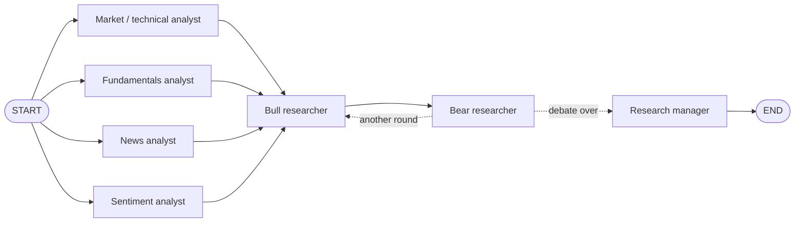

# Multi-Agent Investment Research (LangGraph + Claude)

A team of Claude agents researches a US stock: four analysts gather and interpret data in
parallel, a bull and a bear debate the evidence, and a research manager makes the final
**BUY / HOLD / SELL** call with a written investment plan.

Inspired by [TauricResearch/TradingAgents](https://github.com/TauricResearch/TradingAgents),
simplified to the **Analyst Team** and **Researcher Team** (no trader, risk team or portfolio manager).

> Educational project. Nothing it produces is financial advice.

## Architecture



| Agent | Model | What it does |
|---|---|---|
| Market / technical analyst | Haiku 5.5 | Trend vs. SMA 50/200, RSI, MACD, returns, 52-week range, volume |
| Fundamentals analyst | Haiku 5.5 | Valuation, growth, margins, balance sheet, free cash flow, last 4 quarters |
| News analyst | Haiku 5.5 | Material company-specific news and how the price reacted |
| Sentiment analyst | Haiku 5.5 | Analyst ratings and targets, rating trend, short interest, headline tone |
| Bull / bear researchers | Haiku 5.5 | Debate for N rounds, rebutting each other and conceding fair points |
| Research manager | Sonnet 5.5 | Judges the debate on evidence and returns a structured decision + written plan |

Each analyst is a **tool-calling agent**: it decides which data tools to call (up to 3 rounds),
then writes a report of under 400 words ending in a Bullish / Bearish / Neutral verdict.

## Setup

Requires **Python 3.11+**.

```bash
git clone <this repo> && cd <repo folder>
python3 -m venv .venv            # on macOS with Anaconda: /opt/anaconda3/bin/python -m venv .venv
source .venv/bin/activate
pip install -r requirements.txt
cp .env.example .env             # then open .env and paste your keys
```

`.env` needs an `ANTHROPIC_API_KEY` ([get one here](https://platform.claude.com/settings/keys)).
LangSmith keys are optional; with them, every LLM call is traced at [smith.langchain.com](https://smith.langchain.com).

## Usage

```bash
python main.py NVDA                  # one ticker
python main.py NVDA AAPL WMT         # several tickers + a summary table
python main.py NVDA --rounds 1       # shorter debate
```

Built for US stocks. Canadian listings such as `DRY.V` also work (prices are labeled in CAD), but
Yahoo's data for small caps is thin, so treat those reports as lower-evidence.

Example output:

```
▶ Researching NVDA (as of 2026-11-05)
  ✓ market_analyst finished (7s)
  ✓ news_analyst finished (8s)
  ✓ sentiment_analyst finished (8s)
  ✓ fundamentals_analyst finished (11s)
  ✓ bull_researcher finished (15s)
  ✓ bear_researcher finished (28s)
  ✓ bull_researcher finished (40s)
  ✓ bear_researcher finished (48s)
  ✓ research_manager finished (70s)

  NVDA: BUY (confidence 58/100, 3-6 months)
  Cost ≈ $0.051 · 70s · Report: reports/NVDA_2026-11-05.md
```

Each run saves:
- `reports/<TICKER>_<DATE>.md`: decision at a glance, the four analyst reports, the full debate, the manager's plan, and a disclaimer
- `reports/<TICKER>_<DATE>.json`: the structured decision (rating, confidence, horizon, reasons, risks), token usage and cost

### LangGraph Studio

Watch the graph run node by node in the browser:

```bash
pip install "langgraph-cli[inmem]"
langgraph dev
```

It opens LangGraph Studio (https://smith.langchain.com/studio/?baseUrl=http://127.0.0.1:2024).
Pick the `research` graph and start a run with the input `{"ticker": "NVDA"}` (`as_of_date` defaults to today).

## Configuration

Everything tunable lives in [`src/config.py`](src/config.py):

| Setting | Default | Meaning |
|---|---|---|
| `QUICK_MODEL` / `DEEP_MODEL` | `claude-haiku-5-5` / `claude-sonnet-5-5` | Analysts and debaters / research manager |
| `QUICK_EFFORT` / `DEEP_EFFORT` | `medium` / `high` | How much each model thinks before answering |
| `MAX_DEBATE_ROUNDS` | `2` | One round = one bull turn + one bear turn |
| `MAX_TOOL_ROUNDS` | `3` | Tool-call rounds per analyst before it must write |
| `PRICE_LOOKBACK`, `NEWS_LIMIT`, ... | `1y`, `20`, ... | Data windows |

Prompts are plain strings at the top of [`src/analysts.py`](src/analysts.py) (analysts) and
[`src/researchers.py`](src/researchers.py) (bull, bear, manager).

## Cost

Measured on a full NVDA run (Nov 2026): **about $0.05 per ticker**, mostly the single Sonnet call.

| Step | Calls | Cost |
|---|---|---|
| 4 analysts (Haiku, with tools) | ~10 | ~$0.005 |
| 4 debate turns (Haiku) | 4 | ~$0.003 |
| Research manager (Sonnet) | 1 | ~$0.04 |

## Tests

```bash
pytest
```

All tests run **offline** with a fake LLM and fake data: no API key, no network, no cost. They
check the node order (4 analysts → bull → bear → bull → bear → manager), the fan-in join, the
debate loop, graceful failure of a data source, and report rendering.

## Project structure

```
├── main.py              # CLI runner
├── langgraph.json       # LangGraph Studio config
├── src/
│   ├── config.py        # all tunable settings
│   ├── state.py         # shared graph state + InvestmentDecision schema
│   ├── llm.py           # quick (Haiku) and deep (Sonnet) Claude clients
│   ├── data.py          # Yahoo Finance data → plain text
│   ├── tools.py         # data functions as LangChain tools
│   ├── analysts.py      # 4 tool-calling analyst agents
│   ├── researchers.py   # bull, bear and research manager
│   ├── graph.py         # LangGraph wiring
│   └── report.py        # Markdown / JSON report rendering
├── tests/               # offline tests (fake LLM)
├── docs/graph.mmd       # Mermaid diagram generated from the graph
└── DECISIONS.md         # design decisions, phase by phase
```

## Troubleshooting

| Problem | Fix |
|---|---|
| `ModuleNotFoundError` or syntax errors on install | Your Python is too old. Check `python --version` is 3.11+; on macOS, don't use the system `/usr/bin/python3` (3.9) |
| `authentication_error` / "Could not resolve authentication" | `ANTHROPIC_API_KEY` is missing or wrong in `.env` (no quotes or spaces needed) |
| A report says "DATA UNAVAILABLE" or "data unavailable" | That data source failed (bad ticker, Yahoo rate limit, network). The run continues without it. Wait a minute and retry for rate limits |
| `YFRateLimitError` / many empty results | Yahoo is rate-limiting you. Space out runs, especially with many tickers |
| `KeyError: 'ticker'` when running a node or graph directly | The graph needs at least `{"ticker": "NVDA"}` as input |
| Rating shows `UNAVAILABLE` | The research manager call failed. The error is in the JSON file's `decision.error` |

## Disclaimer

This is an educational project exploring multi-agent LLM systems. Its output is generated by AI
from free public data, may be wrong or out of date, and is **not financial advice**.
