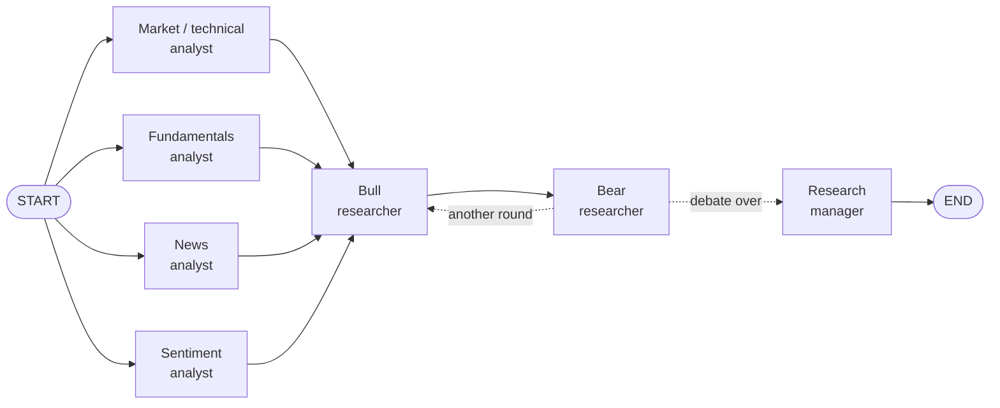
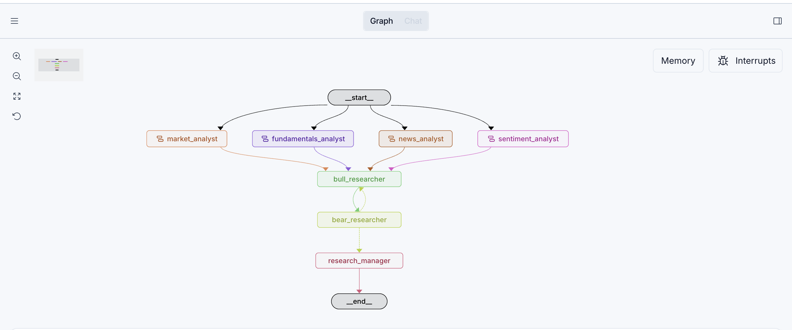
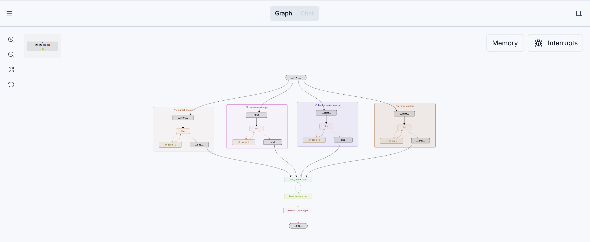

# Multi-Agent Equity Research

**A team of Claude agents researches a stock the way an equity research desk would: four analysts work in parallel, a bull and a bear debate the evidence, and a research manager makes the call.**

[](https://github.com/Nomunbileg1/multi-agent-equity-research/actions/workflows/tests.yml)


[](LICENSE)

## What it does

Give it a ticker and it runs a [LangGraph](https://github.com/langchain-ai/langgraph) workflow of
seven Claude agents. Four **tool-calling analysts** (market/technical, fundamentals, news,
sentiment) pull live data from Yahoo Finance at the same time and each write a short report. A
**bull** and a **bear** researcher then debate those reports for several rounds, rebutting each
other and conceding fair points. Finally, a **research manager** on a stronger model judges the
debate on evidence and returns a **BUY / HOLD / SELL** rating with a confidence score and a
written investment plan, as both Markdown and structured JSON.

Inspired by [TauricResearch/TradingAgents](https://github.com/TauricResearch/TradingAgents),
simplified to the Analyst Team and Researcher Team.

## Architecture



| Agent | Model | Role |
|---|---|---|
| Market / technical analyst | Claude Haiku 5.5 | Trend vs. SMA 50/200, RSI, MACD, returns, 52-week range, volume |
| Fundamentals analyst | Claude Haiku 5.5 | Valuation, growth, margins, balance sheet, free cash flow, last 4 quarters |
| News analyst | Claude Haiku 5.5 | Material company news and how the price reacted |
| Sentiment analyst | Claude Haiku 5.5 | Analyst ratings and targets, rating trend, short interest, headline tone |
| Bull / bear researchers | Claude Haiku 5.5 | Debate for N rounds, each rebutting the other's latest argument |
| Research manager | Claude Sonnet 5.5 | Judges on evidence, commits to a rating, writes the plan (structured output) |

Each analyst is its own small agent loop: it decides which data tools to call (up to 3 rounds),
reads the results, then writes a report of under 400 words ending in a Bullish / Bearish / Neutral verdict.

## Demo

The research graph in LangGraph Studio:



Expanded, Studio shows each analyst's own `llm ⇄ tools` agent loop, all four running in parallel:



Excerpt from a real run ([full NVDA report](examples/NVDA_2026-11-05.md)):

> | Rating | Confidence | Time horizon |
> |---|---|---|
> | **BUY** | 58/100 | 3-6 months |
>
> **BUY**, confidence 58/100, time horizon 3-6 months. Build the position in stages rather than all at once.
>
> The thesis is that a 25% drawdown, driven by sector flow with no company-specific negative event,
> has pushed NVDA to 11.4x forward earnings (PEG 0.24) while revenue grows 105.9% and operating
> margin expands. [...] Technicals argue against paying up all at once, though, so I would scale in.

More examples, all generated on 2026-11-05:

| Report | Profile | Decision | Cost |
|---|---|---|---|
| [NVDA](examples/NVDA_2026-11-05.md) | Mega-cap, sharp sector selloff | BUY · 58 | $0.051 |
| [NFGC](examples/NFGC_2026-11-05.md) | Small-cap gold developer, one covering analyst | SELL · 60 | $0.047 |
| [DRY.V](examples/DRY.V_2026-11-05.md) | Canadian micro-cap explorer, prices in CAD | SELL · 68 | $0.040 |

Each report has a matching `.json` file with the structured decision, token usage and cost.

## LangGraph concepts demonstrated

| Concept | Where |
|---|---|
| **Parallel fan-out / fan-in**: four analysts run at once; the debate waits for all of them via a join edge | [`src/graph.py`](src/graph.py) |
| **Conditional edges and loops**: the bull ⇄ bear debate loops until a round limit, then routes to the manager | [`src/graph.py`](src/graph.py) |
| **Shared typed state**: one `TypedDict`; each node returns only the keys it updates | [`src/state.py`](src/state.py) |
| **Tool-calling agents**: hand-built `llm ⇄ ToolNode` loops with `tools_condition` and a tool-round cap | [`src/analysts.py`](src/analysts.py) |
| **Streaming**: `graph.stream(stream_mode="updates")` drives live progress in the CLI | [`main.py`](main.py) |
| **Multi-model routing**: a cheap model for high-volume work, a stronger one for the final judgment | [`src/llm.py`](src/llm.py) |
| **Structured output**: a Pydantic `InvestmentDecision` via Claude's native JSON-schema output | [`src/researchers.py`](src/researchers.py) |
| **Offline testing with a fake LLM**: a scripted fake model exercises tools, the loop and failures for free | [`tests/`](tests/) |
| **Graceful failure**: a broken data source or model call becomes "data unavailable", not a crash | [`src/tools.py`](src/tools.py) |

## Quickstart

Requires Python 3.11+ and an [Anthropic API key](https://platform.claude.com/settings/keys).

```bash
git clone https://github.com/Nomunbileg1/multi-agent-equity-research.git
cd multi-agent-equity-research
python3 -m venv .venv
source .venv/bin/activate
pip install -r requirements.txt
cp .env.example .env          # then paste your ANTHROPIC_API_KEY into .env
python main.py NVDA
```

```
▶ Researching NVDA (as of 2026-11-05)
  ✓ market_analyst finished (7s)
  ✓ news_analyst finished (8s)
  ✓ sentiment_analyst finished (8s)
  ✓ fundamentals_analyst finished (11s)
  ✓ bull_researcher finished (15s)
  ✓ bear_researcher finished (28s)
  ✓ bull_researcher finished (40s)
  ✓ bear_researcher finished (48s)
  ✓ research_manager finished (70s)

  NVDA: BUY (confidence 58/100, 3-6 months)
  Cost ≈ $0.051 · 70s · Report: reports/NVDA_2026-11-05.md
```

More ways to run it:

```bash
python main.py NVDA AAPL WMT       # several tickers + a summary table
python main.py NVDA --rounds 1     # shorter debate
pytest                             # offline tests: no API key, no cost
```

**LangGraph Studio:** `pip install "langgraph-cli[inmem]"`, then `langgraph dev`. Pick the
`research` graph and start a run with `{"ticker": "NVDA"}`.

**Tracing (optional):** add `LANGSMITH_API_KEY` to `.env` to see every LLM call at [smith.langchain.com](https://smith.langchain.com).

Built for US stocks. Canadian listings such as `DRY.V` also work (prices are labeled in CAD), but
Yahoo's data for small caps is thin, so treat those reports as lower-evidence.

## Configuration

All settings live in [`src/config.py`](src/config.py):

| Setting | Default | Meaning |
|---|---|---|
| `QUICK_MODEL` / `DEEP_MODEL` | `claude-haiku-5-5` / `claude-sonnet-5-5` | Analysts and debaters / research manager |
| `QUICK_EFFORT` / `DEEP_EFFORT` | `medium` / `high` | How much each model thinks before answering |
| `MAX_DEBATE_ROUNDS` | `2` | One round = one bull turn + one bear turn |
| `MAX_TOOL_ROUNDS` | `3` | Tool-call rounds per analyst before it must write |
| `PRICE_LOOKBACK`, `NEWS_LIMIT`, ... | `1y`, `20`, ... | Data windows and indicator settings |

Prompts are plain strings at the top of [`src/analysts.py`](src/analysts.py) and
[`src/researchers.py`](src/researchers.py).

## Cost per run

About **$0.04–0.05 per ticker**, measured on real runs. Most of it is the single Sonnet call.

| Step | Calls | Cost |
|---|---|---|
| 4 analysts (Haiku, with tools) | ~10 | ~$0.005 |
| 4 debate turns (Haiku) | 4 | ~$0.003 |
| Research manager (Sonnet) | 1 | ~$0.03–0.04 |

## Project structure

```
├── main.py              # CLI runner
├── langgraph.json       # LangGraph Studio config
├── src/
│   ├── config.py        # all tunable settings
│   ├── state.py         # shared graph state + InvestmentDecision schema
│   ├── llm.py           # quick (Haiku) and deep (Sonnet) Claude clients
│   ├── data.py          # Yahoo Finance data → plain text for the LLM
│   ├── tools.py         # data functions as LangChain tools
│   ├── analysts.py      # 4 tool-calling analyst agents
│   ├── researchers.py   # bull, bear and research manager
│   ├── graph.py         # LangGraph wiring
│   └── report.py        # Markdown / JSON report rendering
├── tests/               # offline tests (fake LLM, fake data)
├── examples/            # real generated reports
├── docs/                # diagram and screenshots
└── DECISIONS.md         # design decisions and findings, phase by phase
```

## Troubleshooting

| Problem | Fix |
|---|---|
| Install errors or syntax errors | Check `python --version` is 3.11+. On macOS, the system `/usr/bin/python3` (3.9) is too old |
| `authentication_error` | `ANTHROPIC_API_KEY` is missing or wrong in `.env` |
| A report says "DATA UNAVAILABLE" | That data source failed (bad ticker, Yahoo rate limit, network). The run continues without it |
| `YFRateLimitError` or empty results | Yahoo is rate-limiting you. Space out runs, especially with many tickers |
| `KeyError: 'ticker'` | The graph needs at least `{"ticker": "NVDA"}` as input |
| Rating shows `UNAVAILABLE` | The research manager call failed. See `decision.error` in the JSON file |

## Roadmap

- [x] Tool-calling analysts that choose their own data
- [ ] Memory: a SQLite checkpointer to save, resume and compare runs over time
- [ ] Better data: Finnhub / Alpha Vantage / FMP for news and fundamentals, Reddit for social sentiment
- [ ] Streamlit UI: type a ticker and watch the agents work
- [ ] Notebook walkthrough that runs the graph step by step
- [ ] Historical "as-of" mode to sanity-check past calls

## Disclaimer

This is an educational project exploring multi-agent LLM systems. Its output is generated by AI
from free public data, may be wrong or out of date, and is **not financial advice**.

## License

[MIT](LICENSE)

## About

Built by **Nomunbileg (Bill) Sukhbold** ([@Nomunbileg1](https://github.com/Nomunbileg1)).
